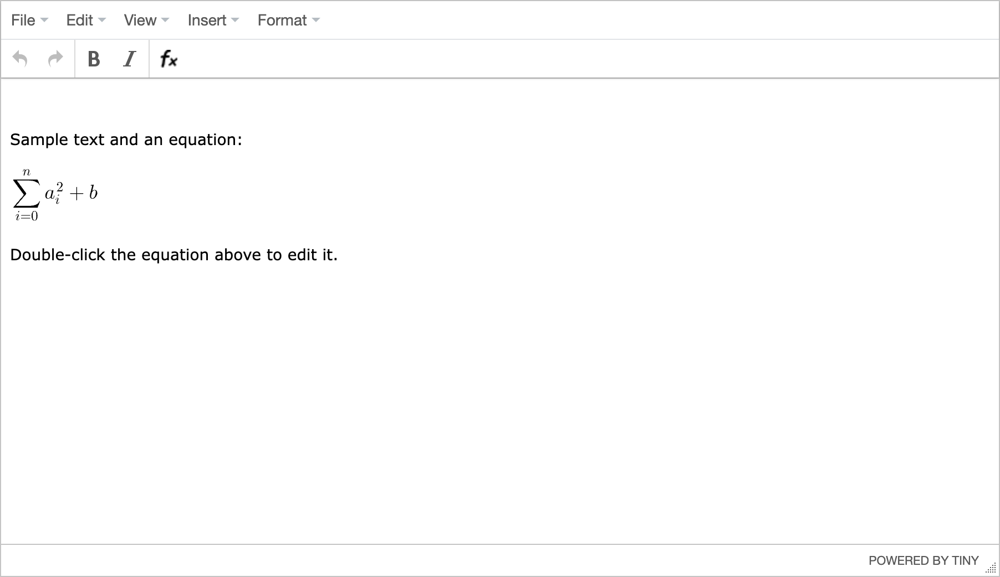
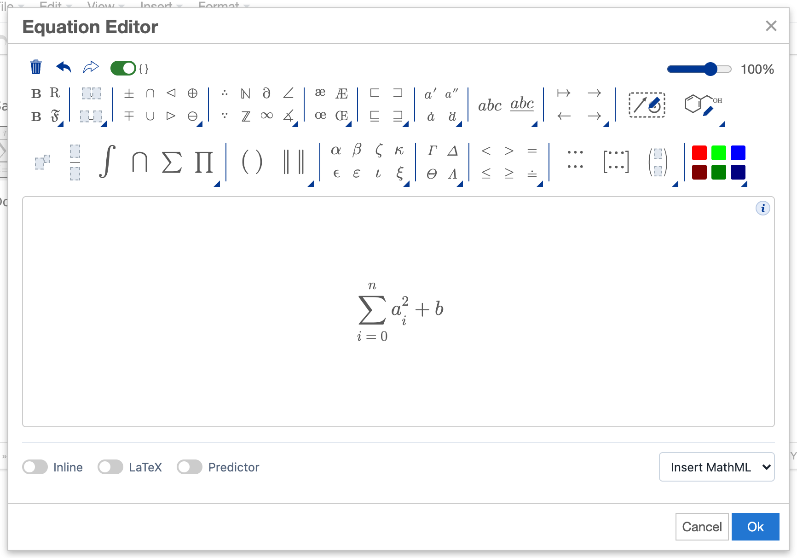

# fxEditor for TinyMCE 4

The fxEditor plugin for TinyMCE 4 adds an **fx** button to the editor's toolbar (and an
*Equation...* item to its Insert menu). It opens fxEditor, CodeCogs' equation editor, in a dialog:
a toolbar of symbols and structures, a rendered maths view to build the equation in, and a LaTeX
view that stays in step with it. The author chooses how the equation goes in at the cursor - as
MathML (the default) or as an SVG image - and double-clicking an inserted equation opens it for
editing again.

This plugin is for sites still running TinyMCE 4. On TinyMCE 6 or 7, use
[fxEditor for TinyMCE 6 and 7](https://github.com/willzyba/tinymce_v6).

> **TinyMCE is not ours.** This repository is a complete TinyMCE 4 download (version 4.9.11, the last TinyMCE 4 release), the
> work of TinyMCE's own authors (today Tiny Technologies, Inc.), under its own licence
> (the GNU LGPL, version 2.1 - see `license.txt`). It is included unchanged, with the fxEditor
> plugin added at `plugins/eqneditor/`. Only `plugins/eqneditor/` and `example.html` are
> CodeCogs' work. For TinyMCE itself, see [www.tiny.cloud](https://www.tiny.cloud).

## Screenshots



*The **fx** button on TinyMCE 4's toolbar, beside an equation in the document.*



*The fxEditor dialog, opened from the fx button.*

## Links

- [Documentation and live demo](https://fxplugins.codecogs.com/docs/tinymce4.html)
- [Customise and download](https://fxplugins.codecogs.com/docs/tinymce4.html#customise) - design
  the editor's toolbar, colour and sizes, and download it with an example page
- [All fxEditor plugins](https://fxplugins.codecogs.com)
- [fxEditor](https://fxeditor.codecogs.com)

## Installing from git

```bash
git clone https://github.com/willzyba/tinymce_v4.git
```

If you already have TinyMCE 4, copy the plugin's folder, `plugins/eqneditor`, into your own
TinyMCE 4's `plugins` folder. (TinyMCE 4 loads a plugin from `plugins/<name>/plugin.min.js`, so
the folder name must stay `eqneditor`.) Then name `eqneditor` in both `plugins` and `toolbar`, and
give it your licence key:

```js
tinymce.init( {
    selector: '#mytextarea',
    plugins: 'eqneditor',
    toolbar: 'undo redo | bold italic | eqneditor',
    eqneditor_server: 'fxtex.codecogs.com',
    eqneditor_licence: 'your-licence-key',       // from fxeditor.codecogs.com/purchase - see below
    eqneditor_design: { colour: '#0f7a4d' }      // optional
} );
```

The equation editor itself is fetched from `fxtex.codecogs.com` the first time it is needed, so
you always get the current editor.

MathML needs a stylesheet on the page that displays it. The plugin loads it into the editing area
for you; on the page that finally shows your content, add:

```html
<link rel="stylesheet" href="https://fxtex.codecogs.com/fxtex.css">
```

To try the plugin straight from the clone, open `example.html`, which loads the TinyMCE in this
repository. Replace `{{EQN_SERVER}}` in it with `fxtex.codecogs.com` and `{{FXTEXPRO_KEY}}` with
your licence key.

## Licence key

Equations are rendered by fxTeX Pro, which needs a licence key for your domain. Without one,
equations show the reason they cannot render in place of the maths.

Get your licence key from [fxeditor.codecogs.com/purchase](https://fxeditor.codecogs.com/purchase).

The key goes in the `eqneditor_licence` option of `tinymce.init()`. The full set of options:

| Option | Default | |
|---|---|---|
| `eqneditor_licence` | | Your fxEditor licence key. Required. |
| `eqneditor_design` | | The editor's look: dialog width, height and scale, toolbar panels and size, colour, equation and markup sizes, undo/redo, how the dialog opens. Build one in [Customise and download](https://fxplugins.codecogs.com/docs/tinymce4.html#customise). |
| `eqneditor_server` | `'fxtex.codecogs.com'` | Host the equation editor's own code is loaded from. A bare host means https; a full origin is used as it is. |
| `eqneditor_render_url` | `'https://latex.codecogs.com'` | The rendering service for equations inserted as images. Point it at a self-hosted fxTeX Server to keep equations inside your network. |
| `eqneditor_script_url` | from server | Full URL of the equation editor bundle. |
| `eqneditor_css_url` | from server | Full URL of the equation editor stylesheet. |
| `eqneditor_mathml_css_url` | from server | The MathML stylesheet loaded into the editing area. |

## Licence

The fxEditor plugin (`plugins/eqneditor/`) and `example.html` are Copyright (c) 2026
CodeCogs, Zyba Ltd., released under the MIT licence - see
[`plugins/eqneditor/LICENSE`](https://github.com/willzyba/tinymce_v4/blob/main/plugins/eqneditor/LICENSE).

TinyMCE - everything else in this repository - is the work of TinyMCE's own authors (today Tiny
Technologies, Inc.) and is licensed under the GNU Lesser General Public License, version 2.1; see
[`license.txt`](license.txt). fxEditor and fxTeX Pro are licensed by CodeCogs - see
[fxeditor.codecogs.com](https://fxeditor.codecogs.com).
